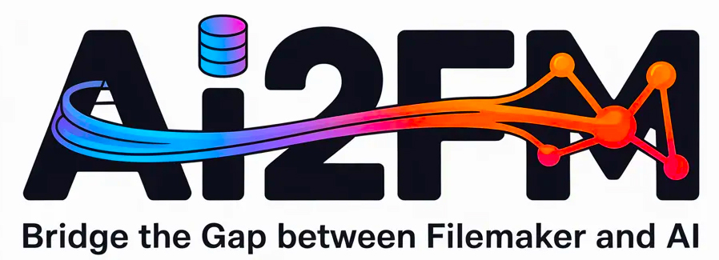

# ai2fm — Low-Latency Vibe Coding for FileMaker 🚀

## ai2fm-community
Welcome to the official community and issue tracker for **ai2fm**! 

[ai2fm](https://ai2fm.com/) is a VS Code extension that bridges the gap between FileMaker's strict XML clipboard format and modern AI code generation. It turns any VS Code-compatible editor into a full FileMaker IDE and provides a lossless, bidirectional translation pipeline so you can easily refactor, document, and extend your FileMaker scripts using plain text and AI agents (Claude, Codex, Gemini, Copilot, Local LLMs).

---

## 🐞 Bug Reports & Feature Requests

While the core translation engine is proprietary, **this repository serves as our public community hub**. 

If you run into an edge case, a dropped variable, or a compilation error, we want to know so we can patch it immediately.

* **Found a Bug?** [Open a Bug Report](../../issues/new?template=bug_report.yml) and include your failing `.fmscript` or XML snippet.
* **Have an Idea?** [Submit a Feature Request](../../issues/new?template=feature_request.yml) for new IDE enhancements, autocomplete templates, or script step additions.

### 📄 Verified Claris Clipboard Bugs

During the R&D for ai2fm we found, documented, and reported to Claris a set of bugs in FileMaker's clipboard serialisation — dropped values, renamed XML tags, and structure changes that silently break a step when it is copied between FileMaker 2025 and 2026. Each one is backed by real captured files you can reproduce yourself, alongside how ai2fm reads and bridges it.

➡️ **[Read the Claris Clipboard Bugs catalogue](https://axelareu.github.io/ai2fm-community/claris_bugs/claris_clipboard_bugs.html)**  ·  [source on GitHub](claris_bugs/claris_clipboard_bugs.md)

### 🏋️ Benchmark: fmIDE, one script, 5,452 steps

Russell Watson's [fmIDE](https://github.com/fmIDE/fmIDE) main script, with its 800-line [fmJAML](https://github.com/fmIDE/fmJAML) calculation. Its 37,162 lines of clipboard XML become **9,721 lines of `.fmscript`** in under 6 seconds. The files are here, with FileMaker's own 71,945-line Save-as-XML for comparison.

➡️ **[See the fmIDE benchmark](benchmarks/fmIDE/README.md)**

### 🧾 A free sample of the ai2fm Agent Pack

**Execute SQL** is one complete page from the $`\color{#0969DA}\textbf{ai2fm Agent Pack, the ai2fm Corpus for AI Agents}`$, free to read, so you can see the quality of what the full product includes: the step's `.fmscript` syntax and every parameter, fourteen tested examples (a complete create, read, update and delete set), and the FileMaker files they come from. Every example opens as a coloured page.

➡️ **[See the Execute SQL step](https://axelareu.github.io/ai2fm-community/fmscript-standard/execute-sql/execute-sql.html)**  ·  [source on GitHub](fmscript-standard/execute-sql/)

---

## ⚡ The Workflow (Vibe Coding)

Turn hours of manual XML reconstruction into seconds. Because scripts live as text files in your IDE, AI agents see the whole relationship graph at once, and your scripts become Git-versionable.

1.  **Copy from FileMaker:** Select script steps in FileMaker and copy.
2.  **Translate (Ctrl+Alt+T):** In your IDE, translate the clipboard XML into readable `.fmscript` text.
3.  **Ask the AI:** Let your preferred AI agent refactor or extend the script in plain text.
4.  **Paste Back (Ctrl+Alt+F):** Rebuild the FileMaker-native XML on your clipboard and paste it straight back into the Script Workspace.

---

## 🛠️ Features

One activated extension: the IDE tools and the FileMaker round trip.

### FileMaker IDE Tools
Turns VS Code-compatible editors (VS Code, Cursor, Devin, Antigravity, Kiro, VSCodium, Trae, Qoder) into a FileMaker environment.
* **Autocomplete & Autoformat:** Native support for `.fmscript`, including instant `If` and `Loop` templates.
* **Live Validation:** Squiggles and Problems-panel updates as you type to prevent broken XML pastes.
* **Hover Docs:** Step documentation directly from the local FileMaker KB.
* **Clipboard I/O:** Copy XML from the editor to the FM clipboard (XMSS, XMFN, XMFD, XMTB, XML2) or read the FM clipboard into the editor.

### FileMaker Round Trip (Server-Side)
The server-side round trip between FileMaker XML and readable script text.
* **Bidirectional Translation:** FM → Text and Text → FM.
* **Complete Coverage:** Supports all 214+ FileMaker script steps.
* **AI Guardrails:** Hallucination detection and multi-line step handling via a bracket-depth parser.
* **Localization:** Auto-translates script step labels to your local FileMaker install language on paste-back.
* **Safe Degradation:** Missing TO, field, and sub-script references are safely commented out—nothing is silently lost.

---

## ⌨️ Quick Shortcuts

| Windows | macOS | Action |
| :--- | :--- | :--- |
| **`Ctrl+Alt+T`** | **`Cmd+Opt+T`** | **FM → Text:** the FileMaker clipboard as a readable script, in a new file named after the script |
| **`Ctrl+Alt+I`** | **`Cmd+Opt+I`** | **FM → Text at the cursor:** insert the FileMaker clipboard into the `.fmscript` you are in |
| **`Ctrl+Alt+F`** | **`Cmd+Opt+F`** | **Text → FM:** check the script, then put it on the FileMaker clipboard, ready to paste |
| **`Ctrl+Alt+Q`** | **`Cmd+Opt+Q`** | **Auto-convert:** the editor, or the selection, from XML to `.fmscript` or back, opened beside it; the clipboard is not touched |
| **`Ctrl+Alt+G`** | **`Cmd+Opt+G`** | **Read the FileMaker clipboard** into the editor as raw XML |
| **`Ctrl+Alt+V`** | **`Cmd+Opt+V`** | **Copy XML** from the editor to the FileMaker clipboard as script steps (XMSS) |

---

## 🔒 Privacy-First Architecture

Your proprietary business logic never stays on our servers. 

The XSLT transform runs server-side, but payloads move over TLS, are processed entirely in volatile memory, and are **discarded the instant the response is sent.** * No disk writes.
* No logs of script content.
* No AI training on customer code—ever. 

---

## 💳 Licensing

v2.5 and later have no permanent free tier. v2.4 is no longer offered for new downloads; existing installations are not disabled by this change.

* **21-Day Demo:** the complete extension at no cost for 21 days. No credit card required. Registration and machine activation are required. After expiry, the extension's active features are locked until a valid licence is entered.
  The paid Agent Pack is not included in the demo.
* For a limited time, **Professional Seat — \$120 / yr:** the activated extension, the FileMaker round trip and the $`\color{#0969DA}\textbf{ai2fm Agent Pack, the ai2fm Corpus for AI Agents}`$.

➡️ **[Start the 21-day demo or buy a licence at ai2fm.com](https://ai2fm.com/)**

---

## 📥 Installation

1. Register at [ai2fm.com](https://ai2fm.com/) and download the `.vsix` extension file.
2. Open your preferred editor (VS Code, Cursor, Devin, Antigravity, Kiro, VSCodium, Trae or Qoder).
3. Press `Ctrl+Shift+P` (`Cmd+Shift+P` on Mac) and run: **`Extensions: Install from VSIX…`**
4. Select the `.vsix` file.
5. Click the **ai2fm icon** in the left-hand bar, then **Enter License Key**. The key is in your demo or purchase email; entering it activates this computer.

---

**Built by developers, for developers.** © 2026 Dimitris Kokoutsidis / [axelar.eu](https://axelar.eu) | [Contact Support](mailto:support@ai2fm.com)
